## Open windows

| Window | What it does |
| --- | --- |
| [**StableBar**](https://github.com/Seb-GRAF/StableBar) | A native menu bar for macOS. I co-maintain it: 200+ commits, one of them about my own beard. |
| [**Apartment Search**](https://github.com/M4n0x/flat-scrapping) | Six Swiss rental sites on one map. Flat hunting in Lausanne, automated. |
| [**Multi-pass**](https://github.com/M4n0x/multi-pass) | Fills in site passwords from regex rules. Unlocks with Touch ID. |
| [**Akamai Debug Helper**](https://github.com/M4n0x/akamai-debug-extension) | Tells you why the cache said no. |
| [**Fodmap Lens**](https://github.com/M4n0x/fodmap-lens) | Scan a grocery barcode, get its FODMAP score. |

## System report

`uptime: since 2014` `load: 3 cakes` `background: running · cycling · skiing` `known issue: may start the robot uprising`
