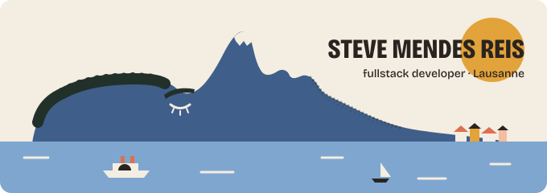
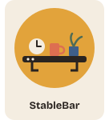
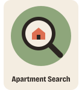
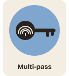
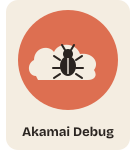
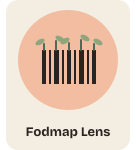
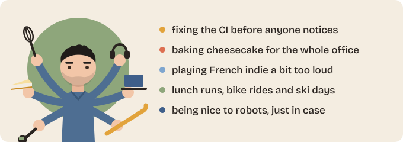

Hi, I'm **Steve**, a fullstack developer at [Liip](https://www.liip.ch) in Lausanne. Before that I worked on the **Human Brain Project** at CHUV. On weekends I ski down my own nose.

## Things I make

## Also known for

The Alps are just me, napping.

